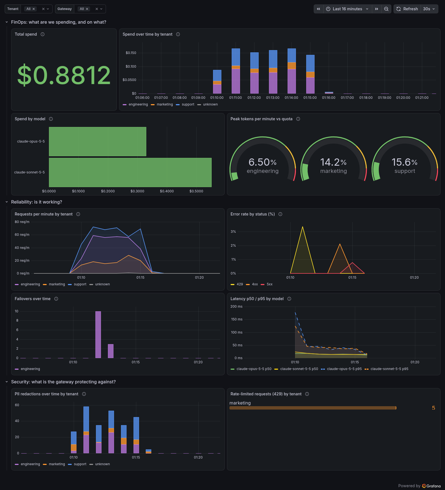

# Aegis AI Gateway

A self-hosted AI gateway built on the [LiteLLM](https://github.com/BerriAI/litellm) proxy. Your apps send OpenAI-format requests to Aegis. Aegis checks which tenant is calling, removes sensitive data from the prompt, enforces each tenant's token budget, and forwards the request to the model provider (Anthropic Claude). If that model is throttled, down or too slow, Aegis switches to a fallback model. Every request, successful or not, produces a usage event (tokens, cost, latency, outcome) that ends up in InfluxDB, and a Grafana dashboard shows cost, reliability and security at a glance.

This is a learning project, built one small step at a time.

## How a request flows

```
Client (OpenAI format)
   │  Authorization: Bearer <master key>
   │  Tenant-ID: engineering
   ▼
LiteLLM proxy (Docker, port 4000)
   1. Master key check          → 401/400 if wrong
   2. tenant_hook.py            → 400 missing Tenant-ID, 403 unknown tenant / model not allowed;
                                  sets the fallbacks this tenant may use
   3. pii_hook.py               → replaces PII with [REDACTED_<TYPE>]
   4. budget_hook.py            → reserves the estimated tokens in Redis, or 429 + Retry-After
   5. failover_hook.py          → notes start time and tenant (never rejects)
   6. telemetry_hook.py         → notes the requested model (never rejects)
   ▼
LiteLLM router: primary model ──(429 / 5xx / timeout)──▶ fallback model
                 (retries, timeouts, cooldowns from router_settings)
   ▼
Anthropic API (Claude): only ever sees the redacted prompt
   ▼
budget_hook.py records the real token count of the model that answered
   ▼
Response + x-aegis-pii-*, x-aegis-ratelimit-* and x-aegis-model-used / x-aegis-fallback headers

Off the request path, for every request (success or failure):
telemetry_hook.py → usage event → in-memory buffer → Redis Stream → telemetry-consumer → InfluxDB
```

Hooks 1–6 run **once per request, before any model is called**, so a fallback sends the same checked, scrubbed and budgeted request.

## Features

- **Multi-tenancy.** Every request must send a `Tenant-ID` header. Each tenant in `gateway/tenants.yaml` has a list of allowed models and a tokens-per-minute quota.
- **PII scrubbing.** Before a request leaves the gateway, every message is scanned (all roles, including system and multi-part content), and these are replaced:

  | Data | Placeholder |
  |---|---|
  | US SSN (`123-45-6789`) | `[REDACTED_SSN]` |
  | Credit card numbers (Luhn-checked) | `[REDACTED_CREDIT_CARD]` |
  | Email addresses | `[REDACTED_EMAIL]` |
  | US phone numbers | `[REDACTED_PHONE]` |
  | API keys (`sk-...`, `AKIA...`, `ghp_...`, Slack, Google) | `[REDACTED_API_KEY]` |

  Logs record only the tenant and the count per type, never the original text. Scrubbing is on by default and can be turned off per tenant.
- **Pluggable detection.** Detectors implement the `PIIDetector` interface in `gateway/pii.py`. A regex detector is used today; another detector, such as Amazon Comprehend, can be swapped in without changing the hook.
- **Per-tenant token budgets.** Each tenant's `tpm_quota` is enforced over a **sliding 60-second window** stored in Redis.
  - Before the call, the gateway estimates the request's tokens (prompt tokens + `max_tokens`) and reserves them. If they don't fit, it returns `429` with a `Retry-After` header and the tenant, limit and current usage.
  - After the call, the estimate is replaced with the real token count from the response, so the window reflects actual usage. A failed call gives its reservation back.
  - Every check-and-reserve runs as one Lua script inside Redis. It's atomic, so concurrent requests can't slip past the limit together.
  - One tenant hitting its budget never affects another.
- **Automatic failover.** Each model has a fallback. When the primary is throttled, down or too slow, LiteLLM's router retries or switches to the fallback, and a circuit breaker skips a failing model for a while. See [Automatic failover](#automatic-failover).
- **Usage and cost telemetry.** One event per request (tenant, models, fallback, tokens, LiteLLM-calculated cost, latency, status, PII count, rate-limited), never any prompt or response text. Events are published off the request path to a Redis Stream and written to InfluxDB by a separate consumer. See [Usage telemetry](#usage-telemetry).
- **Dashboard and alerting.** A Grafana dashboard provisioned as code (FinOps, Reliability, Security), plus a per-tenant spend alert. See [Dashboard and alerting](#dashboard-and-alerting).

### Response headers

| Header | Example | Meaning |
|---|---|---|
| `x-aegis-pii-redactions` | `2` | PII values replaced in this request (`disabled` / `unavailable` if not scrubbed) |
| `x-aegis-pii-types` | `EMAIL=1,SSN=1` | Count per PII type |
| `x-aegis-ratelimit-limit` | `50000` | The tenant's tokens per minute |
| `x-aegis-ratelimit-remaining` | `49788` | Tokens left in the window after this request's estimate (`unknown` if Redis is down) |
| `x-aegis-model-used` | `claude-sonnet-5-5` | The model that actually answered |
| `x-aegis-fallback` | `true` | Whether the answer came from a fallback model |
| `Retry-After` | `42` | On `429` only: seconds until enough tokens slide out of the window |

### When a dependency fails

Both hooks that rely on something that can break let you choose what happens, through an environment variable (set it in `.env`):

| Setting | Default | `open` | `closed` |
|---|---|---|---|
| `AEGIS_PII_FAIL_MODE` (PII detector broken) | `closed` | send the prompt unscrubbed, log a warning | reject with `503`, log an error |
| `AEGIS_RATELIMIT_FAIL_MODE` (Redis down) | `open` | allow without a budget check, log a warning | reject with `503`, log an error |

The defaults differ on purpose. A leaked SSN can't be taken back, so PII fails closed. A few minutes without budget checks costs at most some extra tokens, so the rate limiter fails open and the gateway keeps working.

## Automatic failover

Failover is done by **LiteLLM's router**, configured under `router_settings` in `gateway/config.yaml`. Aegis adds a policy on top of it.

### What LiteLLM does

- **Fallbacks:** `claude-opus-5-5` → `claude-sonnet-5-5`, and `claude-sonnet-5-5` → `claude-opus-5-5`, one hop.
- **Timeouts:** 120 seconds per attempt.
- **Retries on the same model,** per error type: one retry on 5xx (with a short backoff, about 0.5–2s); none on 429 or timeouts, which fail over straight away; none on 4xx.
- **Circuit breaker (cooldown):** a model that keeps failing is skipped for `cooldown_time` (30 seconds), so requests go straight to the fallback instead of waiting for a broken model every time. What trips it is set per model in `model_info.allowed_fails_policy`: the 1st 429, the 2nd timeout, or the 3rd 5xx within a minute. LiteLLM's failure counting can lag slightly, so a request or two more may reach the failing model first (in the demo, 503s tripped it after 5 calls). A 429's `Retry-After` sets how long the model is skipped. Because the policy is set **per model**, each error type has its own counter (at router level they share one).
- **Streams that fail before the first token** fall back seamlessly.

### What Aegis adds

- **Which errors may fail over** (`gateway/failover.py`). LiteLLM on its own falls back on *any* error. Aegis allows it only when another model could actually help:

  | Error | Fails over? | Why |
  |---|---|---|
  | `429` rate limited | yes | that model is throttled; another one isn't |
  | `5xx`, connection errors | yes | the provider is having trouble |
  | timeouts | yes | the model is too slow right now |
  | primary in cooldown | yes | the circuit breaker is skipping it |
  | `400`, `401`, `403`, `404`, `422` | **no** | the request or credentials are wrong; the backup fails the same way |
  | content policy, context too long | **no** | same request, same refusal |

  It also stops 401s from tripping the circuit breaker: a bad key says nothing about the model's health.
- **Fallbacks respect `allowed_models`.** A request only falls back to a model the tenant may use. If `marketing` may only use `claude-sonnet-5-5`, its requests never fall back to Opus. Any `fallbacks` sent by the client are discarded, so they can't be used to get around `allowed_models`.
- **Logging.** One line per failover, with no prompt content:
  ```
  aegis.failover WARNING failover tenant=engineering primary=claude-opus-5-5 error=ServiceUnavailableError fallback=claude-sonnet-5-5 outcome=answered latency_ms=2230
  ```
  `error=cooldown` means the primary was skipped by the circuit breaker. `latency_ms` is the time from the request reaching the gateway to the fallback answering.
- **Headers:** `x-aegis-model-used` and `x-aegis-fallback`.

### Streaming

- **Before the first token:** the failed primary has sent nothing yet, so LiteLLM switches to the fallback and the client receives one clean answer.
- **After some text was sent:** the client has already received part of the primary's answer with HTTP 200, so switching would glue two different answers together. The stream ends with an error instead, and the client must retry.

## Usage telemetry

Every request, successful or rejected, produces exactly one usage event:

```
gateway (hot path)                      │  cold path, separate processes
                                        │
telemetry_hook.py builds the event      │
  → TelemetryEmitter (in-memory buffer) │
  → background task → RedisStreamSink ──┼─▶ Redis Stream "aegis:usage"
                                        │      → telemetry-consumer (consumer group)
                                        │      → InfluxDB bucket "usage"
```

### The event

| Field | Example | Notes |
|---|---|---|
| `timestamp_ns` | `1791856469571695048` | when the gateway recorded the outcome |
| `request_id` | `b7bff36a-…` | LiteLLM's call id |
| `gateway` | `main` / `sandbox` | which gateway sent it |
| `tenant` | `engineering` | `unknown` if missing or not in `tenants.yaml` |
| `requested_model` | `claude-opus-5-5` | `other` if not in any tenant's `allowed_models` |
| `model_used` | `claude-sonnet-5-5` | `none` if the request failed |
| `fallback` | `true` | answered by a different model than requested |
| `prompt_tokens`, `completion_tokens` | `100`, `40` | from the provider's response |
| `cost_usd` | `0.0006` | LiteLLM's `response_cost`; left out if the model has no known price |
| `latency_ms` | `812.5` | from the request reaching the gateway to the outcome |
| `status_code` | `200`, `429`, `503` | what the client received |
| `pii_redactions` | `2` | how many values the PII hook replaced |
| `rate_limited` | `true` | rejected by **our** token budget (a provider 429 is `false`) |

The event is built field by field from this list. Nothing is copied from the request or response wholesale, so **prompt and response text can never be in it**; a test checks the raw bytes in Redis.

Unknown tenants and models are stored as `unknown` / `other` rather than whatever the client sent, so a client can't create unlimited tag values (see below).

### Cost

The cost comes from LiteLLM (`response_cost`), not from prices written into our code. LiteLLM ships a price list (`model_prices_and_context_window.json`) with input and output prices per token for each known model, and multiplies those by the token counts.

- `LITELLM_LOCAL_MODEL_COST_MAP=True` (set in `docker-compose.yml`) makes it use the list **bundled in the pinned image**. Without it, LiteLLM downloads the latest list from GitHub at startup, so prices could change without a version change.
- **For a model it doesn't know,** LiteLLM can't compute a cost: `cost_usd` is left out of the event and the gateway logs `telemetry_cost_unknown` once per model. You fix that by giving the model its own prices (`input_cost_per_token` / `output_cost_per_token` in its `litellm_params`), which is what `config.sandbox.yaml` does for the fake chaos models.

### Never slowing down or breaking a request

- **Hooks only build a small dict and append it to an in-memory buffer:** no network, no waiting. A background task sends batches of up to 100 events to Redis.
- **If Redis is down,** events stay in the buffer (up to 10,000) and the task retries with growing waits. A `telemetry_sink_unavailable` warning is logged once, and `telemetry_sink_recovered` when it's back.
- **If the buffer is full,** the oldest events are dropped and `telemetry_buffer_full` is logged.
- **A bug in event building** logs `telemetry_event_failed` and never reaches the request.

### From the stream to InfluxDB without losing or double-counting events

The `telemetry-consumer` service reads `aegis:usage` as part of the consumer group `influx-writer`:

1. Redis hands each entry to one consumer and marks it **pending** for that consumer.
2. The consumer writes a batch to InfluxDB and only then **acks** it (`XACK`), which removes it from the pending list.
3. **If the consumer crashes, or InfluxDB is down,** the entries stay pending. On its next round (or after a restart, using the same `CONSUMER_NAME`) it re-reads its own pending entries first and writes them again. Pending entries of a consumer that never comes back are taken over with `XAUTOCLAIM` after 60 seconds idle.
4. **Writing an event twice doesn't count it twice.** InfluxDB identifies a point by measurement + tags + timestamp; the same event written again overwrites itself.
5. **Entries that can't be read** go to `aegis:usage:dead` and are acked, so they can't block the rest.

The stream is capped at about 100,000 entries, so a consumer stopped for a very long time loses the oldest unprocessed events rather than filling Redis.

### Tags vs fields

InfluxDB stores measurement `llm_usage` in the `usage` bucket (30-day retention):

- **Tags** (indexed, for filtering and grouping): `gateway`, `tenant`, `requested_model`, `model_used`, `fallback`, `status_code`, `rate_limited`.
- **Fields** (values, for adding up and averaging): `prompt_tokens`, `completion_tokens`, `total_tokens`, `cost_usd`, `latency_ms`, `pii_redactions`, and `request_id`.

Every distinct combination of tag values is a separate **series**, and InfluxDB keeps an index entry in memory for each one. The tags above have a handful of values each, so there are at most a few thousand series. `request_id` is unique per request: as a tag it would create a new series for every request (**high cardinality**), and the index would grow until queries slow down and memory runs out. So it's a field: still stored, still searchable, but not indexed. The same reasoning is why unknown tenants and models are bucketed.

### Checking that events land

```bash
# How many events are in the stream, and is the consumer keeping up? (pending 0, lag 0 = all done)
docker compose exec redis redis-cli XLEN aegis:usage
docker compose exec redis redis-cli XINFO GROUPS aegis:usage

# What the consumer is doing
docker compose logs telemetry-consumer

# Cost per tenant over the last hour, straight from InfluxDB
docker compose exec influxdb influx query 'from(bucket:"usage") |> range(start:-1h) |> filter(fn:(r) => r._field == "cost_usd") |> group(columns:["tenant"]) |> sum()'
```

Or open the InfluxDB UI at <http://localhost:8086> (user `admin`, password `INFLUXDB_ADMIN_PASSWORD` from `.env`). Go to **Data Explorer**, pick bucket `usage`, measurement `llm_usage`, and a field such as `cost_usd`.

## Dashboard and alerting



*Six minutes of sandbox traffic (`docker compose run --rm traffic --duration 360`): a marketing burst into its budget, a failover window, bad requests and a short provider outage.*

### Opening it

1. Start everything with `docker compose up -d`.
2. Send some traffic: `docker compose run --rm traffic`.
3. Open <http://localhost:3000>, or the port you set as `GRAFANA_PORT`. Log in with `GRAFANA_ADMIN_USER` / `GRAFANA_ADMIN_PASSWORD` from `.env`; anonymous access is turned off.
4. Go to **Dashboards → Aegis → Aegis - AI Gateway**.

At the top are the **Tenant** dropdown (All, support, engineering, marketing), a **Gateway** dropdown (`main` = real traffic, `sandbox` = fake models), and the time-range picker. The dashboard refreshes every 30 seconds. Each tenant has the same colour in every panel: support blue, engineering purple, marketing orange, unknown grey.

### What each row answers

**FinOps: what are we spending, and on what?**
- **Total spend:** LiteLLM-calculated cost for the selected range.
- **Spend over time by tenant:** stacked bars, so the top of each bar is the total. Shows *when* money is spent and *who* spends it.
- **Spend by model:** where the money goes, by the model that actually answered (fallbacks included).
- **Peak tokens per minute vs quota:** each tenant's busiest minute as a % of its `tpm_quota`. Near 100% means 429s are coming.

**Reliability: is it working?**
- **Requests per minute by tenant:** traffic volume.
- **Error rate by status (%):** share of requests that failed. `429` comes from our budget or from a cooled-down model; `4xx` is other client errors; `5xx` means a provider failed and so did the fallback.
- **Failovers over time:** requests answered by a fallback model. Lots of them means the primary model is struggling.
- **Latency p50 / p95 by model:** typical and worst-case response times, for successful requests. Dashed lines are p95.

**Security: what is the gateway protecting against?**
- **PII redactions over time by tenant:** sensitive values that never reached a model.
- **Rate-limited requests (429) by tenant:** requests our token budget rejected. A tenant that keeps hitting this is misbehaving or under-provisioned.

### Everything is code

| File | What Grafana does with it |
|---|---|
| `grafana/provisioning/datasources/influxdb.yaml` | creates the InfluxDB (Flux) datasource; the token comes from the environment |
| `grafana/provisioning/dashboards/aegis.yaml` | loads every JSON in `grafana/dashboards/` into the folder "Aegis" |
| `grafana/dashboards/aegis-gateway.json` | the dashboard, **generated** by `grafana/build_dashboard.py` |
| `grafana/alerting/spend-alert.template.yaml` | the alert rule, contact point and policy, rendered by `grafana/render_alerting.py` |

UI edits to provisioned items can't be saved. To change the dashboard, edit `grafana/build_dashboard.py`, run `docker compose run --rm build-dashboard`, and commit both files (a test fails if the JSON is out of date). Grafana picks up the new JSON within 30 seconds.

### The spend alert

Every minute, Grafana adds up each tenant's `cost_usd` over the last hour. Any tenant above `AEGIS_SPEND_ALERT_USD` (from `.env`, default `0.05`) fires its own alert. Notifications go to the `alert-logger` container, which prints them:

```bash
docker compose logs -f alert-logger
# ALERT firing tenant=support rule="Tenant spend in the last hour over threshold" summary="Tenant support spent 0.1234 USD in the last hour, over the 0.05 USD threshold."
```

Grafana doesn't fill in environment variables inside alert rules, so a short-lived `grafana-alerting` container renders the rule file with your threshold before Grafana starts. It refuses anything that isn't a positive number. Change the threshold in `.env` and run `docker compose up -d` again.

To send alerts somewhere real later, replace the `console-log` contact point (Slack, email, PagerDuty, …); the rule stays the same.

### Updating the screenshot

```bash
# needs GRAFANA_RENDERER_TOKEN in .env (any random string)
docker compose -f docker-compose.yml -f docker-compose.screenshot.yml up -d grafana grafana-renderer
curl -u "$GRAFANA_ADMIN_USER:$GRAFANA_ADMIN_PASSWORD" -o docs/dashboard.png \
  "http://localhost:3000/render/d/aegis-gateway?orgId=1&from=now-15m&to=now&width=1600&height=1760&kiosk&theme=dark&timeout=90"
docker compose up -d grafana   # back to normal, without the renderer
```

## Project layout

```
gateway/
  config.yaml           LiteLLM config: models, hooks (in run order), failover settings
  config.sandbox.yaml   same hooks and policy, but the models are the chaos server
  tenants.yaml          tenants, allowed models, tpm_quota, pii_scrubbing flag
  tenants.py            loads tenants.yaml, reads the Tenant-ID header
  settings.py           fail-open/closed setting, shared logger
  tenant_hook.py        hook 1: tenant and model checks, per-tenant fallbacks
  pii.py                PIIDetector interface, RegexDetector, redact()
  pii_hook.py           hook 2: scrubs messages, logs counts, adds response headers
  ratelimit.py          sliding-window limiter (Redis + Lua), no LiteLLM code
  budget_hook.py        hook 3: estimates, reserves and records tokens, 429s
  failover.py           which errors may fail over; installs that policy into LiteLLM
  failover_hook.py      hook 4: failover logging and model-used headers
  telemetry.py          EventSink interface, RedisStreamSink, buffered background emitter
  telemetry_hook.py     hook 5: one usage event per request, success or failure
grafana/
  build_dashboard.py    the dashboard as readable code; writes dashboards/aegis-gateway.json
  dashboards/           the generated dashboard JSON Grafana loads
  provisioning/         datasource, dashboard provider (Grafana loads these at startup)
  alerting/             the spend alert rule template
  render_alerting.py    fills the threshold from .env into the alert rule
telemetry/
  consumer.py           reads the usage stream (consumer group) and writes to InfluxDB
  Dockerfile            small image for the consumer (no LiteLLM)
  requirements.txt      the consumer's pinned packages
scripts/
  chaos_llm.py          fake OpenAI-compatible model you can make fail on demand
  failover_demo.py      watch failover live while you break the primary model
  load_test.py          hammers one tenant until 429 while another keeps working
  traffic.py            realistic mixed traffic across all tenants, for the dashboard
  alert_logger.py       receives Grafana alerts and prints them to the console
tests/
  Dockerfile            test image: the same LiteLLM image + pytest + InfluxDB client
  test_*.py             unit tests; rate-limit and telemetry tests against real Redis; failover tests
                        against the chaos server; consumer tests against real Redis + InfluxDB
docs/
  dashboard.png         screenshot of the dashboard
docker-compose.yml      gateway, Redis, InfluxDB, telemetry consumer, Grafana, tests, and the sandbox
docker-compose.screenshot.yml  add-on with Grafana's image renderer, for screenshots
.env.example            the environment variables you need
```

## Getting started

You only need [Docker Desktop](https://www.docker.com/products/docker-desktop/). Everything runs in containers, and all image and package versions are pinned.

1. Create your `.env` from the template:
   ```bash
   cp .env.example .env
   ```
   Then fill in:
   - `ANTHROPIC_API_KEY`: your Anthropic API key
   - `LITELLM_MASTER_KEY`: a password you choose for the gateway (must start with `sk-`)
   - `INFLUXDB_ADMIN_PASSWORD`: a password for the InfluxDB UI (8+ characters)
   - `INFLUXDB_ADMIN_TOKEN`: a long random string (`.env.example` shows how to generate one)
   - `GRAFANA_ADMIN_USER` / `GRAFANA_ADMIN_PASSWORD`: your dashboard login
   - optional: `GRAFANA_PORT` if port 3000 is taken, `AEGIS_SPEND_ALERT_USD` for the alert threshold

   `.env` is git-ignored. Never commit it. The InfluxDB and Grafana admin values are used only when those services start for the **first** time. To change them later, delete their data with `docker compose down -v` (this erases the usage history and Grafana's state).

2. Start everything (Redis and InfluxDB start first and are health-checked):
   ```bash
   docker compose up
   ```
   It's ready when the logs show `Uvicorn running on http://0.0.0.0:4000`. Redis has no port on your machine; only the containers can reach it. InfluxDB's UI is at <http://localhost:8086>, on your machine only.

## Usage

```bash
curl -i http://localhost:4000/v1/chat/completions \
  -H "Content-Type: application/json" \
  -H "Authorization: Bearer $LITELLM_MASTER_KEY" \
  -H "Tenant-ID: support" \
  -d '{
    "model": "claude-sonnet-5-5",
    "max_tokens": 300,
    "messages": [{"role": "user", "content": "Repeat exactly: my SSN is 123-45-6789"}]
  }'
```

The response includes `x-aegis-pii-redactions: 1` and `x-aegis-pii-types: SSN=1`, and the model replies with `[REDACTED_SSN]` because it never received the real number. It also includes the rate-limit headers, `x-aegis-model-used: claude-sonnet-5-5` and `x-aegis-fallback: false`.

On Windows, run curl from Git Bash. In Windows PowerShell 5.1, `curl` is a different command and breaks the JSON quoting.

### Errors

| Situation | Status |
|---|---|
| Missing or blank `Tenant-ID` | `400` |
| Unknown tenant | `403` |
| Tenant asks for a model it's not allowed to use | `403` |
| Request needs more tokens than the tenant's whole per-minute quota | `413` |
| Tenant is over its token budget | `429` + `Retry-After` |
| PII detector or Redis down, and that fail mode is `closed` | `503` |
| Model error that doesn't fail over (e.g. bad request) | the provider's status, unchanged |
| Primary and fallback both failed | the last error |

## Configuring tenants

Edit `gateway/tenants.yaml` and restart the gateway:

```yaml
tenants:
  support:
    allowed_models: [claude-sonnet-5-5]
    tpm_quota: 50000      # tokens per minute, sliding window
    pii_scrubbing: true   # optional, defaults to true
```

Model names must match a `model_name` in `gateway/config.yaml`. A malformed file stops the gateway at startup instead of failing on live requests. A tenant only gets failover to models that are also in its `allowed_models`.

## Running the tests

```bash
docker compose run --rm --build tests
```

The tests run inside the same LiteLLM image as the gateway, and need no API key or credits. The rate-limit tests use a real Redis container (database 15). The failover tests run LiteLLM's real router against the chaos server: healthy, 429, 503, timeout, 401/400, the circuit breaker, and streams that fail before or after their first token. The telemetry tests check the event fields, that no prompt or response text reaches Redis, and that a Redis outage doesn't slow down or fail a request. The consumer tests use real Redis and InfluxDB, each in its own temporary bucket: events land, a crash before the ack is redelivered without double counting, an InfluxDB outage leaves events pending, and unreadable entries are dead-lettered. The Grafana tests check that the committed dashboard JSON matches its generator and the spec, that each tenant has one colour everywhere, and that the alert threshold comes from `.env`. They also run **every panel's Flux query and the alert's query against real InfluxDB** and check the numbers.

## The sandbox: load test, failover demo and traffic

The sandbox is a second gateway (`litellm-sandbox`) with the same hooks, tenants and failover policy, using Redis database 1. Its models are `scripts/chaos_llm.py`, a fake OpenAI-compatible server, so **it never calls Anthropic and costs nothing**:

- `claude-opus-5-5` is `chaos-primary`, which you can switch between `ok`, `429`, `503`, `hang` (never answers), `401`, `400` and `cut` (fails mid-stream).
- `claude-sonnet-5-5` is `chaos-backup`, which always works.
- Every answer is `Hello from <model>. You said: <your message>`, so you can see which model answered and what it received.

Stop the sandbox afterwards with `docker compose --profile test down`.

### Failover demo

In one terminal, start the request loop:

```bash
docker compose run --rm failover-demo
```

In a second terminal, break the primary and fix it again:

```bash
docker compose run --rm failover-demo --set 503    # or 429, hang, 401
docker compose run --rm failover-demo --set ok
```

Each line shows which model answered:

```
  14:02:01  chaos=ok    HTTP 200  model=claude-opus-5-5    fallback=false      19 ms  primary called=1
  14:02:05  chaos=503   HTTP 200  model=claude-sonnet-5-5  fallback=true     2230 ms  primary called=2
  14:02:11  chaos=503   HTTP 200  model=claude-sonnet-5-5  fallback=true       22 ms  primary called=5
  14:02:12  chaos=ok    HTTP 200  model=claude-sonnet-5-5  fallback=true       27 ms  primary called=0
  ...
  14:02:27  chaos=ok    HTTP 200  model=claude-opus-5-5    fallback=false      30 ms  primary called=1
```

- **The first 503s** take about 2 seconds: one retry with backoff, then failover.
- **Once the circuit breaker trips,** the primary isn't called at all (`primary called` stops rising), and the fallback answers in milliseconds.
- **After switching back to `ok`,** the fallback keeps answering until the cooldown ends. Then the primary is back.

`docker compose run --rm failover-demo --auto` runs the whole tour by itself (healthy, 401, 503, hang, 429, with recovery after each) and ends with PASS/FAIL checks.

### Traffic for the dashboard

```bash
docker compose run --rm --build traffic                  # about 90 seconds
docker compose run --rm traffic --duration 300           # longer
```

This sends mixed traffic from all three tenants through the sandbox: different prompt sizes, about 1 in 4 prompts with PII, a marketing burst that overflows its budget (429s), a window where the primary model returns 503s (engineering's Opus requests fail over), and a few bad requests (403, 400). At the end it prints counts per tenant:

```
Requests by tenant (HTTP status counts, and how many were answered by a fallback)
  (no tenant)  400=1  fallback=0
  engineering  200=48  fallback=16
  marketing    200=23  403=2  429=4  fallback=0
  support      200=75  fallback=0
```

The same numbers show up in InfluxDB a few seconds later, tagged `gateway=sandbox` (see [Checking that events land](#checking-that-events-land)).

### Load test

```bash
docker compose run --rm --build loadtest
```

It hammers `marketing` (20,000 tokens/min) with 20 parallel workers while `engineering` sends 2 requests per second, then checks:

```
Result
  marketing    sent=399   200=176   429=223   other=0   limit=20000 remaining=112  retry-after=53s
  engineering  sent=9     200=9     429=0     other=0   limit=100000 remaining=98884
  PASS: marketing was rate-limited (429)
  PASS: marketing saw no errors other than 429
  PASS: engineering kept succeeding (every request 200)
```

It exits with code `0` on PASS and `1` on FAIL. Options: `--hammer`, `--steady`, `--concurrency`, `--max-tokens`, `--duration` (see `--help`).

## Known limitations

- `Tenant-ID` is a claim, not proof: anyone with the master key can send any tenant name. Per-tenant API keys would fix this.
- With the current `tenants.yaml`, only `engineering` can fail over: `support` and `marketing` may only use Sonnet, and Sonnet's fallback (Opus) isn't in their `allowed_models`.
- Both models come from the same provider, so a full Anthropic outage takes down primary and fallback together. A fallback on another provider would need that provider's key.
- `failover.py` hooks into a LiteLLM internal (`Router.async_function_with_fallbacks_common_utils`). If an upgrade changes it, the gateway refuses to start rather than fail over on every error; the failover tests catch behavior changes.
- A provider `401` (bad Anthropic key) reaches the client as `401`, which can look like the client's own master key was wrong.
- Token estimates count `max_tokens` as if the whole reply will be used. Reservations are corrected after the call, but while a request is running its full `max_tokens` counts against the budget.
- Rate-limit and cooldown state lives only in memory (Redis / the gateway process): restarting resets them.
- PII scrubbing covers message content only. It doesn't cover tool-call arguments, the legacy `/completions` `prompt` field or embeddings input.
- The regex detector doesn't find names or street addresses, and it only handles US phone numbers and dashed SSNs.
- Don't run LiteLLM with `--detailed_debug`: it logs raw request bodies before the PII hook runs.
- Telemetry is at-least-once from the stream onward, but not before it. Events still in the gateway's in-memory buffer are lost if the gateway crashes. Redis runs without saving to disk, so a Redis restart loses events not yet consumed. Turning on Redis AOF, or moving to Kinesis, would make the stream durable.
- Requests rejected by the master-key check (before any hook runs) produce no usage event.
- The consumer and Grafana both use the InfluxDB admin token. Separate tokens (write-only for the consumer, read-only for Grafana) would be safer.
- The quota gauge uses calendar minutes (12:00–12:01), while the rate limiter uses a sliding 60 seconds, so the gauge is a close approximation, not the limiter's exact view.
- The dashboard's quota values are copied from `tenants.yaml` when the JSON is generated. After changing quotas, regenerate it (a test catches a stale JSON).
- Two events with identical tags in the same nanosecond would overwrite each other in InfluxDB. In practice this doesn't happen, but it's the price of the "re-write overwrites" trick.
